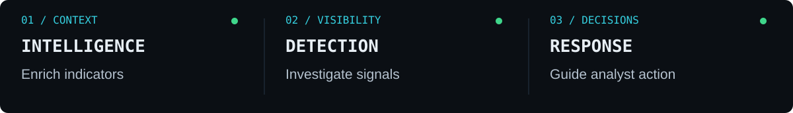
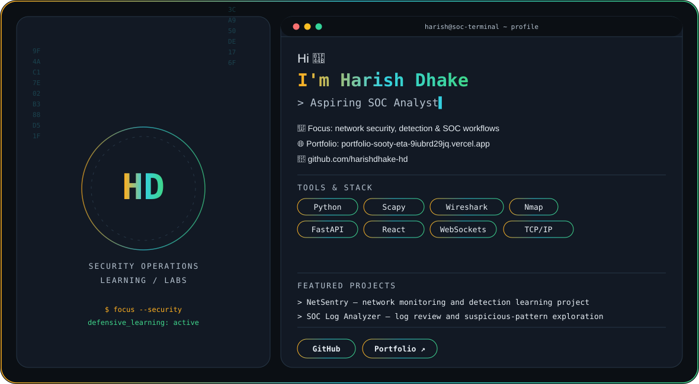
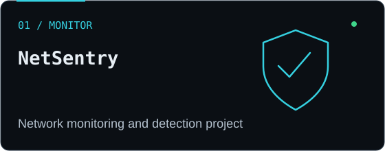
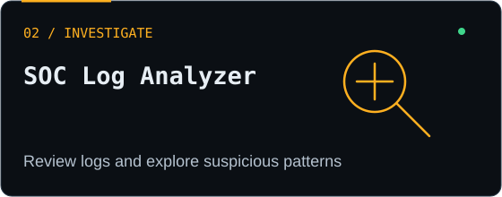
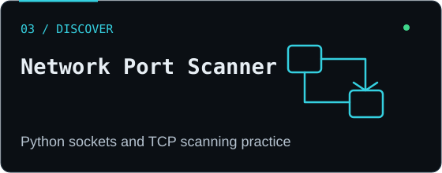
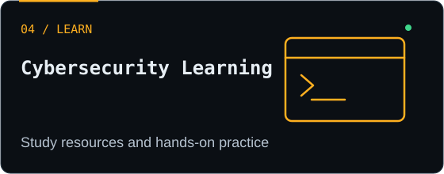
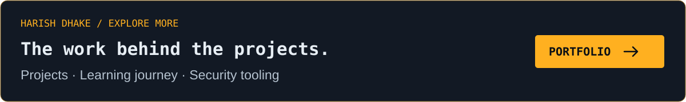

## Hi there 👋

<!--
**harishdhake-hd/harishdhake-hd** is a ✨ _special_ ✨ repository because its `README.md` (this file) appears on your GitHub profile.

Here are some ideas to get you started:

- 🔭 I’m currently working on ...

  

<h1 align="center">Building practical tools for stronger security operations</h1>

SOC Operations · Network Security · Threat Detection · Security Automation

  
  
  

  <a href="#about-me">About</a> · <a href="#featured-projects">Featured projects</a> · <a href="#project-directory">Project directory</a> · <a href="#security-toolkit">Toolkit</a> · <a href="#training-and-learning">Learning</a> · <a href="#collaboration-and-contact">Contact</a>

---

## About me

I'm **Harish Dhake**, a third-year Bachelor of Computer Applications (BCA) student at Modern College of Arts, Science and Commerce, Ganeshkhind, Pune. I'm working toward an entry-level **SOC Analyst / Security Analyst (L1)** role and building practical experience through projects and hands-on learning.

My project work explores network monitoring, packet capture, detection rules, log analysis, and small security utilities. I enjoy understanding how network activity is collected, how suspicious patterns can be identified, and how evidence can help an analyst investigate an event.

<strong>Learn by building · Investigate with evidence · Improve through practice</strong>

## AI-assisted SOC terminal — profile preview

  <picture>
    <source media="(prefers-color-scheme: dark)" srcset="./assets/soc-terminal-dark.svg" />
    <source media="(prefers-color-scheme: light)" srcset="./assets/soc-terminal-light.svg" />
    
  </picture>

## Featured projects

<table>
  <tr>
    <td width="50%" valign="top">
      

      
A Python-based learning project focused on network telemetry, packet capture, and configurable threshold-based detection rules.

      
<strong>Python · Scapy · Network monitoring</strong>

      
<a href="https://github.com/harishdhake-hd/NetSentry">Explore NetSentry →</a>

    </td>
    <td width="50%" valign="top">
      

      
A utility for practising log parsing, searching for suspicious patterns, and summarising security-relevant activity.

      
<strong>Python · Log analysis · Detection basics</strong>

      
<a href="https://github.com/harishdhake-hd/soc-log-analyzer">Explore SOC Log Analyzer →</a>

    </td>
  </tr>
  <tr>
    <td width="50%" valign="top">
      

      
A beginner-friendly project for practising Python socket programming and authorised TCP port scanning in lab environments.

      
<strong>Python · Sockets · TCP/IP</strong>

      
<a href="https://github.com/harishdhake-hd/Port--Scanner-">Explore Port Scanner →</a>

    </td>
    <td width="50%" valign="top">
      

      
Learning repositories that organise cybersecurity topics and support consistent self-directed practice.

      
<strong>Study notes · Learning resources</strong>

      
<a href="https://github.com/harishdhake-hd/Cybersecurity-Roadmap-2025">Cybersecurity Roadmap</a> · <a href="https://github.com/harishdhake-hd/90DaysOfCyberSecurity">90 Days of CyberSecurity</a>

    </td>
  </tr>
</table>

## Project directory

<strong>Browse projects and learning repositories</strong>

| Project | Focus | Technologies / format |
| :--- | :--- | :--- |
| [NetSentry](https://github.com/harishdhake-hd/NetSentry) | Network monitoring, telemetry, and detection-rule learning | Python, Scapy |
| [SOC Log Analyzer](https://github.com/harishdhake-hd/soc-log-analyzer) | Log parsing and suspicious-pattern exploration | Python |
| [Network Port Scanner](https://github.com/harishdhake-hd/Port--Scanner-) | Educational TCP scanning and socket programming | Python, sockets |
| [Cybersecurity Roadmap 2025](https://github.com/harishdhake-hd/Cybersecurity-Roadmap-2025) | Cybersecurity study plan and learning resources | Markdown |
| [90 Days of CyberSecurity](https://github.com/harishdhake-hd/90DaysOfCyberSecurity) | Structured cybersecurity learning | Markdown / study resources |
| [Portfolio source code](https://github.com/harishdhake-hd/portfolio) | Source for personal portfolio | React / JavaScript |
| [Resume repository](https://github.com/harishdhake-hd/Resume) | Resume-related files | Repository contents |

## Live portfolio

<a href="https://portfolio-sooty-eta-9iubrd29jq.vercel.app/">Open my portfolio ↗</a>

## Security learning focus

| Area | Current focus |
| :--- | :--- |
| **Network security** | TCP/IP, packet inspection, traffic analysis, and authorised scanning labs |
| **Monitoring & detection** | Network telemetry, threshold-based rules, suspicious-pattern identification, and alert logging |
| **SOC investigation** | Log review, event summaries, alert triage concepts, and investigation fundamentals |
| **Security development** | Python scripting, sockets, and analyst-focused utilities |
| **SIEM concepts** | Learning SIEM fundamentals, event workflows, and detection concepts |
| **Systems** | Developing Linux and Windows fundamentals for security labs |

## Security toolkit

| Area | Tools and technologies |
| :--- | :--- |
| **Programming** | Python, JavaScript |
| **Network analysis** | Wireshark, Nmap, TCP/IP fundamentals |
| **Packet capture** | Scapy and packet-capture concepts used in network experiments |
| **Backend & APIs** | FastAPI, REST APIs, WebSockets (where implemented in the relevant project) |
| **Frontend** | React |
| **SOC & detection** | Detection rules, log parsing, alert logging, security-event summaries |

## Training and learning

<strong>Current learning and study resources</strong>

- **Cybersecurity learning:** edX courses and training resources.
- **Programming foundations:** Harvard CS50 study.
- **Self-directed study:** [Cybersecurity Roadmap 2025](https://github.com/harishdhake-hd/Cybersecurity-Roadmap-2025) and [90 Days of CyberSecurity](https://github.com/harishdhake-hd/90DaysOfCyberSecurity).
- **Learning priorities:** network traffic investigation, Linux fundamentals, SIEM basics, threat detection, Python automation, and incident-response workflows.

These are learning activities and study priorities, not a claim that every course has been completed. Certifications are not listed unless completion can be confirmed.

## Education and career direction

| Education | Institution | Status |
| :--- | :--- | :--- |
| Bachelor of Computer Applications (BCA) | Modern College of Arts, Science and Commerce, Ganeshkhind, Pune | Third year |

I'm preparing for entry-level **SOC Analyst / Security Analyst (L1)** opportunities and working to improve my ability to review network activity and logs, recognise suspicious patterns, write Python security utilities, learn SIEM workflows, and document findings clearly.

## Collaboration and contact

I'm open to feedback, collaboration, and code reviews on projects related to SOC tooling, network monitoring, and detection experiments.

- **GitHub:** [harishdhake-hd](https://github.com/harishdhake-hd)
- **Repositories:** [Browse my projects](https://github.com/harishdhake-hd?tab=repositories)
- **Portfolio:** [portfolio-sooty-eta-9iubrd29jq.vercel.app](https://portfolio-sooty-eta-9iubrd29jq.vercel.app/)

---

<strong>Building practical security tools, one investigation at a time.</strong> Harish Dhake

- 🌱 I’m currently learning ...
- 👯 I’m looking to collaborate on ...
- 🤔 I’m looking for help with ...
- 💬 Ask me about ...
- 📫 How to reach me: ...
- 😄 Pronouns: ...
- ⚡ Fun fact: ...
-->
